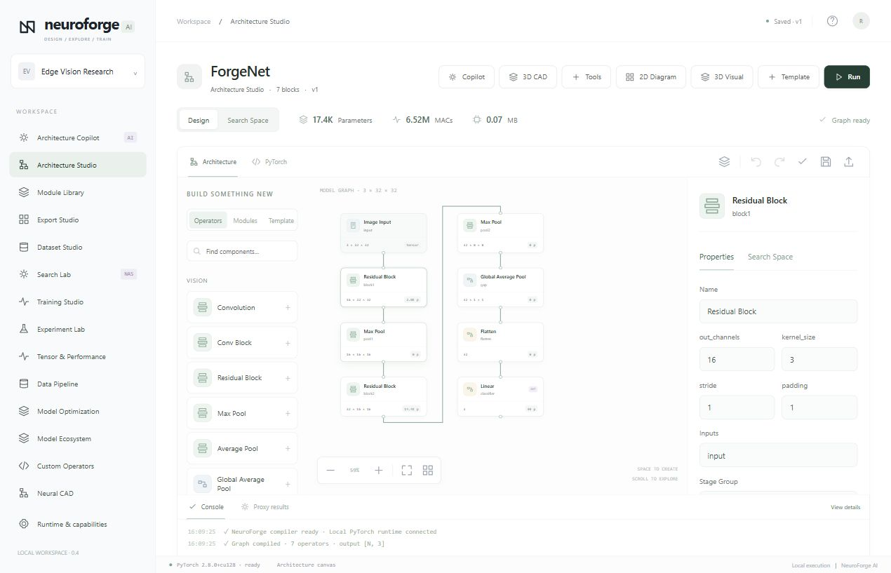
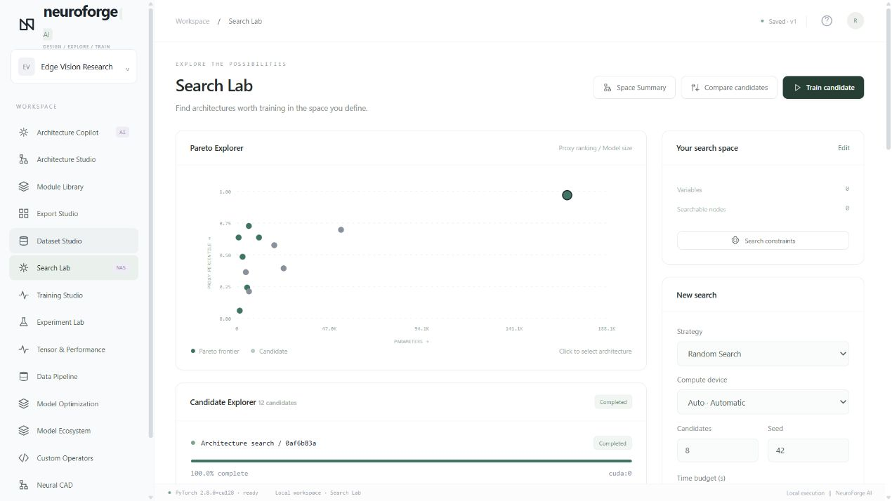
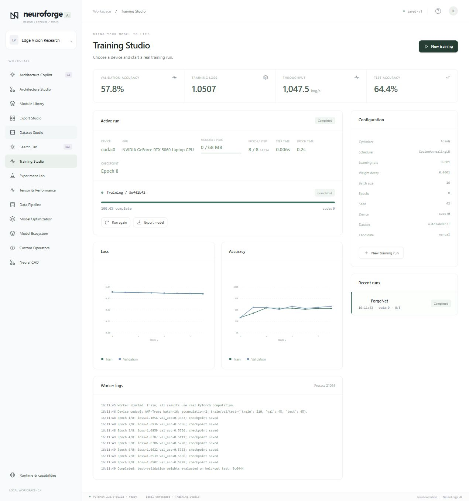
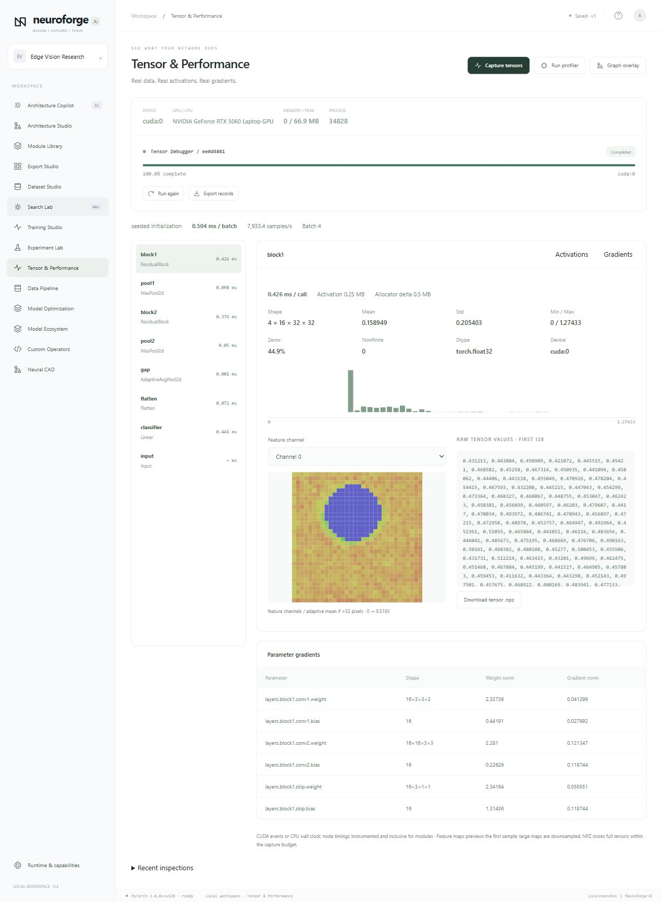
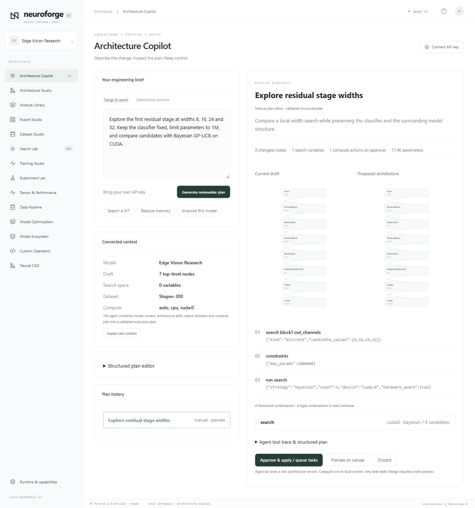
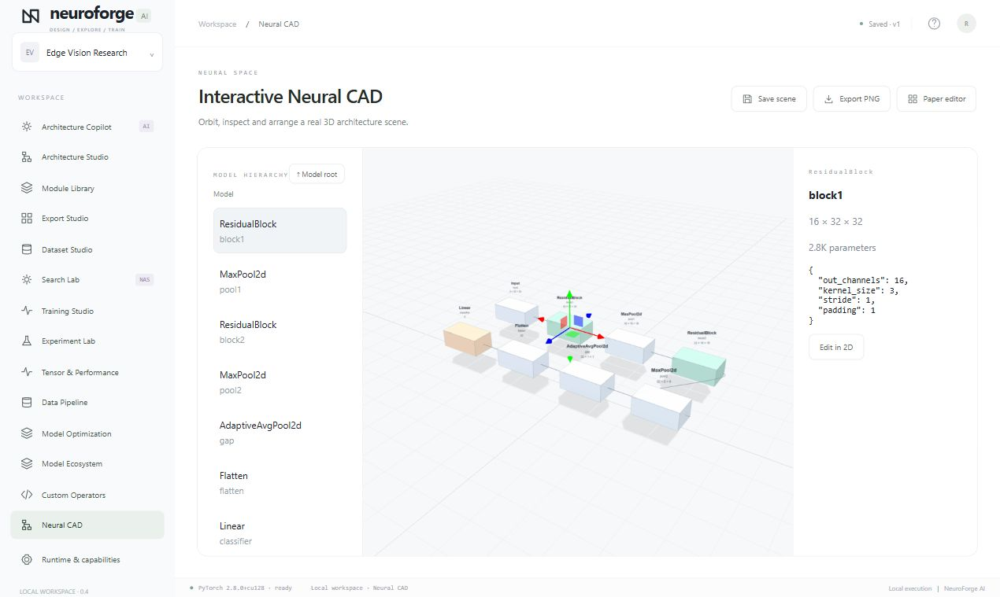
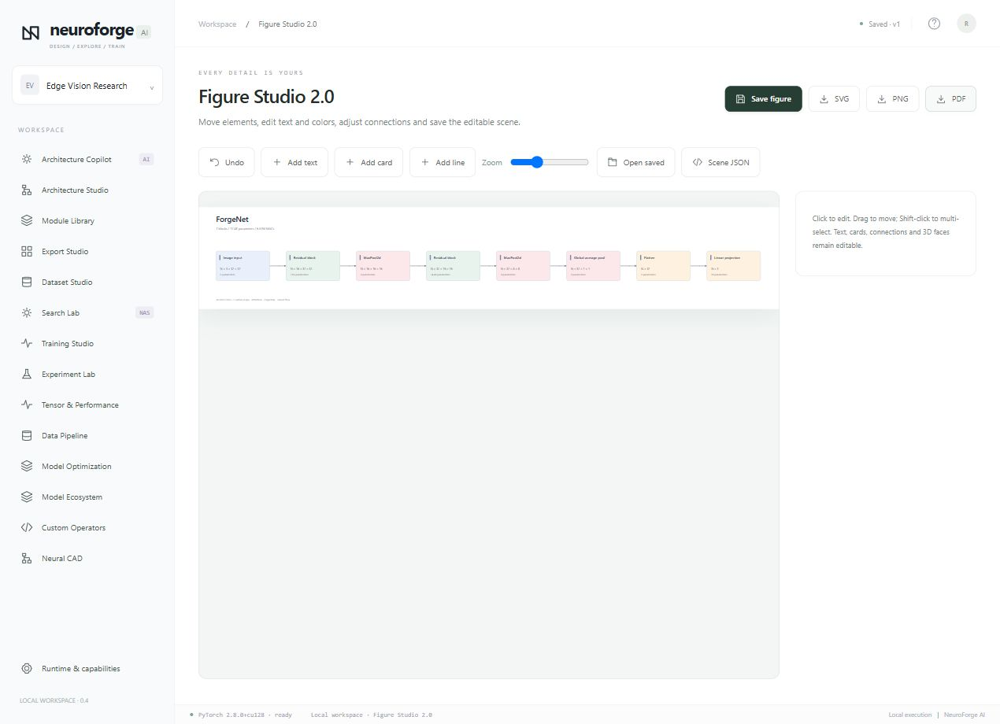

# NeuroForge AI

**Design neural networks visually. Explore architectures intelligently. Train on your own hardware.**

NeuroForge AI is a visual neural network engineering platform that brings model design, architecture search, dataset preparation, PyTorch training, and publication figures into one workspace. Build CNNs and Vision Transformers, turn selected layers into a search space, compare candidates, and train the model you choose.

[Quick start](#quick-start) · [Features](#features) · [Screenshots](#screenshots) · [English manual](docs/NeuroForge-User-Manual-en.md) · [中文手册](docs/NeuroForge-User-Manual-zh-CN.md)



## Features

- **Visual neural network design** — connect operators on a canvas, inspect tensor shapes, edit layer parameters, package reusable modules, and generate runnable PyTorch code.
- **Visual search spaces** — choose searchable parameters, discrete values, numeric ranges, optional branches, block repetitions, and conditional relationships. Keep selected parts of the architecture fixed while exploring others.
- **AutoNAS and hardware-aware search** — run random, evolutionary, finite enumeration, or Bayesian GP-UCB search. Compare proxy rankings, parameter counts, measured latency, throughput, and GPU memory.
- **CPU and CUDA training** — configure AdamW, mixed precision, gradient accumulation, early stopping, and automatic batch sizing. Follow metrics and logs, save checkpoints, and pause or resume runs.
- **Tensor debugging and profiling** — inspect activations, feature maps, gradients, distributions, and layer timings directly alongside the architecture.
- **AI Architecture Copilot** — connect your own API key, describe a model change, and review the proposed graph edits, search settings, and tasks before applying them.
- **Model ecosystem** — import models and weights through torchvision, timm, and Hugging Face adapters. Work with ResNet, EfficientNet, ConvNeXt, ViT, DeiT, Swin, BERT, and GPT-2 classification models.
- **Reusable components** — save subgraphs to Module Library, expose module parameters, and register your own PyTorch operators through the Custom Operator SDK.
- **Editable figures and 3D scenes** — generate SVG, PNG, and PDF architecture diagrams, edit individual figure elements, and arrange models in an interactive WebGL CAD scene.
- **Experiment workflows** — version datasets and architectures, compare experiments, build visual augmentation pipelines, export ONNX models, and automate jobs with a Python SDK and CLI.

## From data to a trained model

1. **Prepare data.** Import an image-classification ZIP or token dataset, inspect samples, and save the split.
2. **Design the model.** Start from a CNN, residual network, ViT, or token Transformer template, or import an existing model.
3. **Define the search.** Select the layers and parameters to explore, then set resource budgets and an optimization strategy.
4. **Compare candidates.** Inspect proxy results and target-device measurements, then instantiate a candidate as a model version.
5. **Train and inspect.** Follow the training curves, capture tensors, profile execution, and compare saved runs.
6. **Export the result.** Save model code, checkpoints, configuration, experiment records, and architecture figures.

## Screenshots

### Architecture search

Explore candidate rankings, Pareto trade-offs, and measurements from your target device.



### CUDA training

Follow loss, accuracy, throughput, GPU memory, and checkpoint progress in Training Studio.



<details>
<summary><strong>Tensor debugger and layer profiling</strong></summary>

Inspect real activation distributions, channel heatmaps, gradient statistics, and per-layer execution measurements.



</details>

<details>
<summary><strong>Architecture Copilot and plan review</strong></summary>

Review architecture changes and search configuration before applying a plan.



</details>

<details>
<summary><strong>Interactive Neural CAD</strong></summary>

Orbit the 3D scene, inspect module shapes, arrange blocks, and export presentation images.



</details>

<details>
<summary><strong>Editable publication figures</strong></summary>

Move cards, edit labels, adjust connectors, and export SVG, PNG, or PDF.



</details>

## Quick start

### Windows

Install Python 3.10 or later, then clone and start the application:

```powershell
git clone https://github.com/Panda-China666/NeuroForge-AI.git
cd NeuroForge-AI
.\start.bat
```

Open **http://127.0.0.1:8787/** in your browser. The startup script creates a local Python environment and installs the application dependencies on first use.

For NVIDIA CUDA training and the model ecosystem adapters:

```powershell
.\setup-cuda.bat
.\setup-ecosystem.bat
.\start.bat
```

### Python environment

```bash
git clone https://github.com/Panda-China666/NeuroForge-AI.git
cd NeuroForge-AI
python -m venv .venv
source .venv/bin/activate
python -m pip install -e .
python run.py
```

Choose **auto**, **cpu**, or a detected **cuda:N** device when starting a task. The Runtime page shows the active PyTorch environment and available devices.

## Your first project

Open **Architecture Studio** and choose a CNN template. Use the included **Shapes-300** dataset to run a proxy analysis, explore a small candidate set in **Search Lab**, and start a short training run. Then import your own data and reuse the same workflow.

For AI assistance, open **Architecture Copilot → Connect API key**, enter your API base URL, model ID, API key, and protocol, then describe your goal. The plan preview shows the proposed architecture, search variables, constraints, and queued tasks. Click **Approve & apply** to execute it.

## Python SDK and CLI

```python
from neuroforge.sdk import NeuroForge

client = NeuroForge("http://127.0.0.1:8787")
project = client.projects()[0]
run = client.train(project["id"], epochs=5, batch_size=16, device="auto")
result = client.wait(run["id"])
print(result["status"])
client.export(run["id"], "training-result.zip")
```

```bash
python -m neuroforge --help
python -m neuroforge projects
python -m neuroforge train --project PROJECT_ID --device auto --wait
```

## Documentation

| Guide | Markdown | PDF | Offline HTML |
|---|---|---|---|
| English user manual | [Read](docs/NeuroForge-User-Manual-en.md) | [Download](docs/NeuroForge-User-Manual-en.pdf) | [Open](docs/NeuroForge-User-Manual-en.html) |
| 中文使用手册 | [阅读](docs/NeuroForge-User-Manual-zh-CN.md) | [下载](docs/NeuroForge-User-Manual-zh-CN.pdf) | [打开](docs/NeuroForge-User-Manual-zh-CN.html) |
| Example files | [Browse](docs/examples) | | |
| Windows desktop build | [Build guide](desktop/README.md) | | |

The manuals cover installation, datasets, graph editing, search spaces, CUDA training, modules, Transformers, Copilot, model imports, custom operators, figure editing, SDK workflows, and backup procedures.

## Technology

Python · PyTorch · FastAPI · SQLite · JavaScript · SVG · Three.js

Model search and training run in isolated workers. The model IR connects the visual editor, compiler, search engine, profiling tools, and export pipeline. Project data, configurations, and run artifacts stay together in a versioned local workspace.
